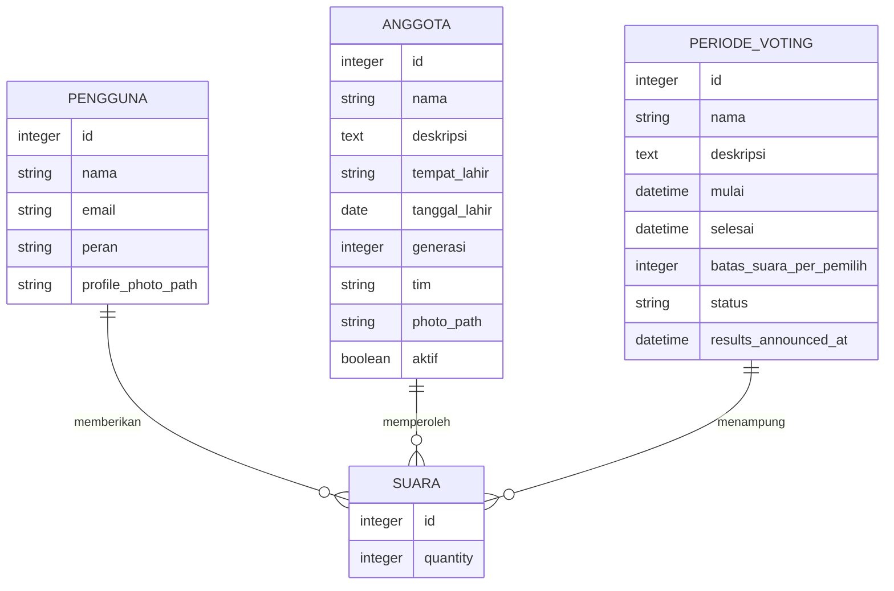
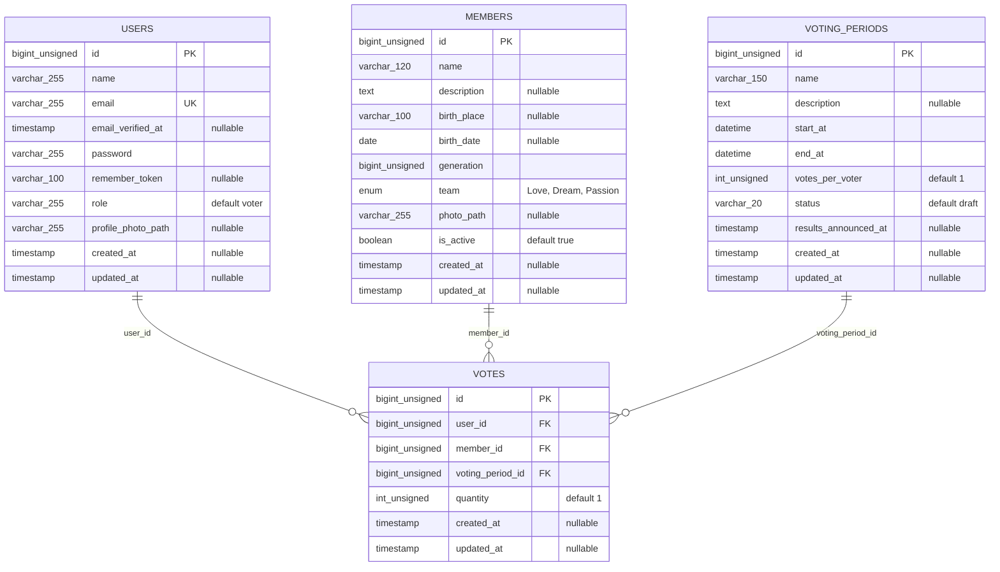

# Model Data Sistem Voting

Dokumen ini berisi CDM (model konseptual) dan PDM (model fisik) berdasarkan
migrasi dan skema database MySQL aplikasi. CDM hanya memuat entitas bisnis;
PDM juga mencakup tabel pendukung Laravel.

## CDM — Conceptual Data Model

Setiap suara dimiliki oleh satu pengguna, ditujukan kepada satu anggota, dan
tercatat pada satu periode voting. Satu pengguna, anggota, atau periode voting
dapat terkait dengan banyak suara.

## PDM — Physical Data Model

### Tabel inti aplikasi

### Tabel pendukung Laravel

Tabel berikut juga ada di database, tetapi tidak memiliki relasi bisnis langsung
dengan entitas voting.

| Tabel | Kolom fisik |
|---|---|
| `password_reset_tokens` | `email varchar(255) PK`, `token varchar(255)`, `created_at timestamp NULL` |
| `sessions` | `id varchar(255) PK`, `user_id bigint unsigned NULL` (indeks, bukan foreign key), `ip_address varchar(45) NULL`, `user_agent text NULL`, `payload longtext`, `last_activity int` |
| `cache` | `key varchar(255) PK`, `value mediumtext`, `expiration bigint` |
| `cache_locks` | `key varchar(255) PK`, `owner varchar(255)`, `expiration bigint` |
| `jobs` | `id bigint unsigned PK`, `queue varchar(255)`, `payload longtext`, `attempts smallint unsigned`, `reserved_at int unsigned NULL`, `available_at int unsigned`, `created_at int unsigned` |
| `job_batches` | `id varchar(255) PK`, `name varchar(255)`, `total_jobs int`, `pending_jobs int`, `failed_jobs int`, `failed_job_ids longtext`, `options mediumtext`, `cancelled_at int NULL`, `created_at int`, `finished_at int NULL` |
| `failed_jobs` | `id bigint unsigned PK`, `uuid varchar(255) UNIQUE`, `connection varchar(255)`, `queue varchar(255)`, `payload longtext`, `exception longtext`, `failed_at timestamp` |
| `migrations` | `id int unsigned PK`, `migration varchar(255)`, `batch int` |

### Kunci, indeks, dan aturan relasi

| Tabel | Kunci dan indeks penting |
|---|---|
| `users` | `id` primary key; `email` unique. |
| `members` | `id` primary key; indeks gabungan (`generation`, `team`) dan indeks `is_active`. |
| `voting_periods` | `id` primary key; indeks gabungan (`status`, `start_at`, `end_at`). |
| `votes` | `id` primary key; foreign key `user_id`, `member_id`, `voting_period_id`; indeks gabungan (`user_id`, `voting_period_id`) dan (`voting_period_id`, `member_id`). |

- Penghapusan pengguna menghapus suara terkait (`cascadeOnDelete`).
- Penghapusan anggota atau periode yang masih memiliki suara ditolak
  (`restrictOnDelete`).
- Status periode yang disebut dalam migrasi adalah `draft`, `published`, dan
  `closed`.
- `votes_per_voter` adalah batas jumlah suara per pemilih dalam periode;
  `quantity` adalah jumlah pada satu baris suara.
- Database tidak memiliki constraint unik untuk pasangan pengguna-periode atau
  constraint yang memastikan total `quantity` mematuhi `votes_per_voter`;
  batas tersebut perlu divalidasi oleh logika aplikasi.

### Catatan kesesuaian migrasi

Skema database saat ini memiliki `users.profile_photo_path`, `users.role`,
`voting_periods.results_announced_at`, dan `votes.quantity`. Namun, file migrasi
`2026_10_29_021339_add_profile_photo_path_to_users_table.php` yang ada di kode
saat ini berisi penambahan `results_announced_at` ke `voting_periods`, bukan
`profile_photo_path` ke `users`. Pastikan migrasi tersebut diselaraskan dengan
skema sebelum menyiapkan database baru.
