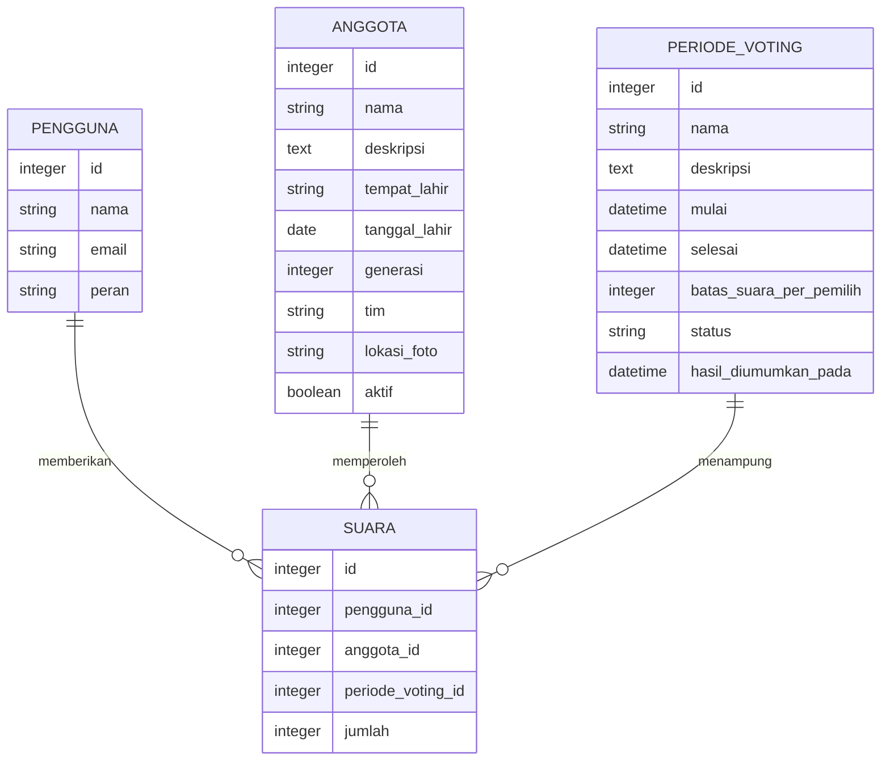
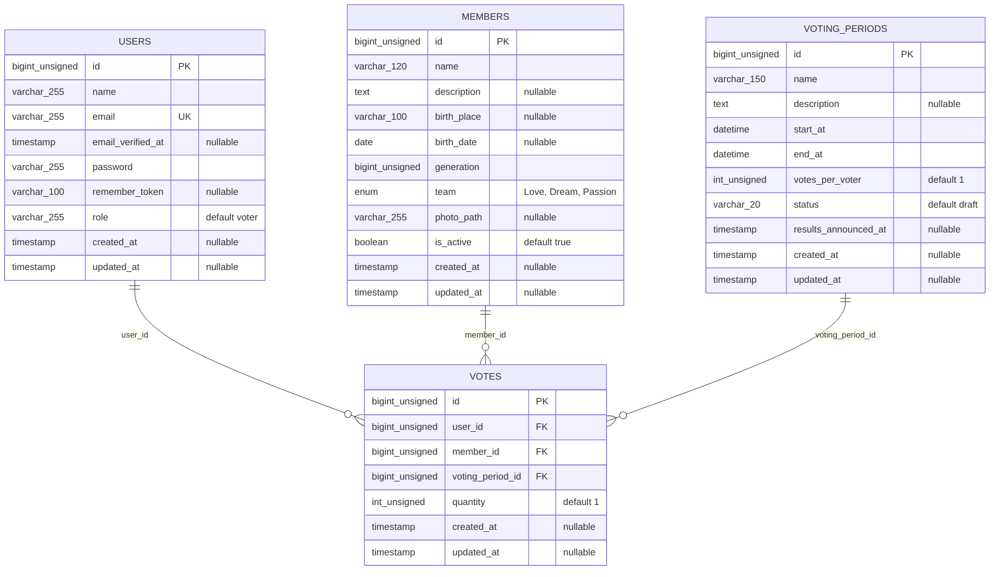

# Model Data Sistem Voting

Dokumen ini berisi CDM (Conceptual Data Model) dan PDM (Physical Data Model)
untuk empat tabel utama sistem voting: `users`, `members`, `voting_periods`,
dan `votes`. Tabel pendukung Laravel tidak ditampilkan. Struktur tabel mengacu
pada file migrasi di `database/migrations`.

## CDM — Conceptual Data Model

CDM memuat empat entitas bisnis utama dan atribut konseptualnya.

Setiap suara berasal dari satu pengguna, ditujukan kepada satu anggota, dan
berada pada satu periode voting. Satu pengguna, anggota, atau periode voting
dapat terkait dengan banyak suara. Batas suara per pemilih disimpan pada
periode; jumlah suara aktual disimpan pada setiap baris suara.

## PDM — Physical Data Model

Diagram berikut hanya menampilkan tabel utama aplikasi. Relasi hanya
digambarkan sebagai foreign key jika constraint tersebut benar-benar
didefinisikan.

### Tabel dan aturan relasi

| Tabel | Kunci, indeks, dan keterangan |
|---|---|
| `users` | `id` primary key; `email` unique. Kolom `role` ditambahkan oleh migrasi terpisah. |
| `members` | `id` primary key; indeks gabungan (`generation`, `team`) dan indeks `is_active`. |
| `voting_periods` | `id` primary key; indeks gabungan (`status`, `start_at`, `end_at`). Status yang disebut dalam migrasi: `draft`, `published`, dan `closed`. |
| `votes` | `id` primary key; foreign key `user_id`, `member_id`, dan `voting_period_id`; indeks gabungan (`user_id`, `voting_period_id`) dan (`voting_period_id`, `member_id`). `quantity` ditambahkan oleh migrasi terpisah. |

- Penghapusan pengguna menghapus suara terkait (`cascadeOnDelete`).
- Penghapusan anggota atau periode yang masih memiliki suara ditolak
  (`restrictOnDelete`).
- `votes_per_voter` adalah batas jumlah suara per pemilih pada satu periode;
  `quantity` adalah jumlah pada satu baris suara.
- Tidak ada constraint unik untuk pasangan pengguna-periode dan tidak ada
  constraint database yang memastikan total `quantity` mematuhi
  `votes_per_voter`; aturan tersebut perlu divalidasi oleh logika aplikasi.

### Catatan kesesuaian migrasi dan kode

- Migrasi `2026_10_29_021339_add_profile_photo_path_to_users_table.php` tidak
  menambahkan `profile_photo_path` ke `users`; isinya menambahkan
  `results_announced_at` ke `voting_periods`.
- Migrasi `2026_10_30_000033_add_results_announced_at_to_voting_periods_table.php`
  juga menambahkan kolom `results_announced_at` yang sama. Jika kedua migrasi
  dijalankan berurutan pada database baru, migrasi kedua berpotensi gagal
  karena kolom tersebut sudah ada.
- Model dan kode aplikasi menggunakan `users.profile_photo_path`, tetapi tidak
  ada migrasi yang membuat kolom itu. Kolom tersebut karena itu tidak
  dicantumkan sebagai kolom fisik `users` pada PDM ini.
- PDM menggambarkan kolom `results_announced_at` satu kali sebagai struktur
  yang dimaksud oleh migrasi. Riwayat migrasi perlu diselaraskan sebelum
  membuat database baru agar kolom itu tidak ditambahkan dua kali.
